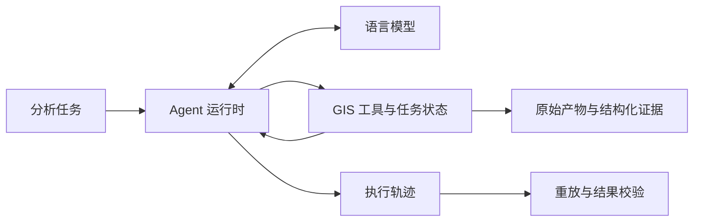

# StrataAgent

StrataAgent 是面向地理空间分析的 Agent，支持通过语言模型调用 GIS 工具完成数据查询、表连接、空间选择、统计和制图，并保存可复核的执行轨迹与分析产物。

## 功能

- **任务执行**：将任务描述转为工具调用，在隔离的任务工作区中维护数据状态，并将工具结果和错误观测传回模型。
- **GIS 工具**：适配 25 项 GeoBenchX 工具，包含 24 个 GIS 操作和 `reject_task`；默认评测 profile 使用其中 12 项工具。
- **运行控制**：设置调用轮数与 deadline，根据工具的并发属性调度调用，回收超时子进程，并区分完成、截断和失败状态。
- **分析证据**：保存表格摘要、字段信息、图像与原始结果，记录数据来源、工具源码摘要和渲染版本。
- **评测与训练**：提供轨迹重放、确定性结果校验、配对消融，以及工具错误恢复的样本构建和 SFT 管线。

## 架构



工具适配层管理 DataFrame、GeoDataFrame 和图像状态；运行时负责模型交互与调用预算。启用证据存储后，模型接收有长度约束的摘要，完整产物通过 evidence 引用保留。

## 安装

基础环境使用 Python 3.10 及以上版本。GIS 评测建议使用 Python 3.11。

```bash
git clone https://github.com/rengong02/StrataAgent.git
cd StrataAgent
uv sync --extra dev
source .venv/bin/activate
```

GIS 运行还需要 GDAL 的 Python 绑定（`osgeo`）和 GIS 依赖。在已配置 GDAL 的环境中安装：

```bash
uv pip install --python "$(command -v python)" -e '.[dev]' -r requirements-gis.txt
```

GeoBenchX 提供工具源码、任务集和 GIS 数据。将它放在仓库同级目录，固定版本后应用补丁：

```bash
git clone https://github.com/Solirinai/GeoBenchX.git ../GeoBenchX
git -C ../GeoBenchX checkout 0edf6109ea5dca3e70fdfe081d39c9ccd0f832fb
git -C ../GeoBenchX apply "$PWD/patches/geobenchx-0001-drop-colorbar-fmt.patch"
git -C ../GeoBenchX apply "$PWD/patches/geobenchx-0002-spatial-select-distinct-features.patch"
```

按 [GeoBenchX 的数据说明](https://github.com/Solirinai/GeoBenchX) 配置数据目录。如果 checkout 位于其他位置，可用 `GEOBENCHX_ROOT` 指定其路径。补丁的用途见 [patches/README.md](patches/README.md)。

## 运行 GIS 任务

设置 `DEEPSEEK_API_KEY` 后，使用 DeepSeek 运行五个任务并保存证据：

```bash
python scripts/run_geobench_tasks.py \
  --provider deepseek --model deepseek-chat --limit 5 \
  --out outputs/solver_runs.jsonl --evidence-dir outputs/evidence
```

也可以通过 `--task-ids` 选择任务，使用 `--max-rounds` 和 `--deadline` 调整执行预算。runner 只选择至少有一条参考方案落在工具白名单内的任务。

输出包含终止状态、工具调用、错误、token 用量和 evidence 引用。LLM judge 用于辅助比较工具方案；数据和工具执行结果使用确定性校验。

## 评测

| 项目 | 冻结结果 |
|---|---|
| 空间选择语义 | 返回 45 个独立国家要素，避免将 7,715 条关联行重复计入统计 |
| 绘图阶段计时 | 同一绘图代码由 74.9861 s 降至 0.1946 s；为局部单次计时 |
| 证据摘要消融 | 9 个配对任务的 token 总量下降 32.9%，双侧检验 `p=0.1171875` |

评测配置、原始记录和适用范围见 [RESULTS.md](RESULTS.md)。局部绘图计时与小样本消融分别报告。

## 工具恢复训练

`strata/train/` 提供合成数据和公开真实数据的恢复轨迹，训练目标为正确参数修正与结构化终止。冻结 candidate 位于 `evals/candidates/`，来源快照位于 `evals/sources/`。

不加载模型的 CPU 检查：

```bash
python scripts/run_real.py --stage base --check-only \
  --bundle-dir evals/candidates/real-48 --run-root outputs/real-check
```

完整训练的安装、数据构建和 GPU 命令见独立项目 [geo-recovery-sft](https://github.com/rengong02/geo-recovery-sft)。两仓库保留各自的运行时代码，安装时使用独立环境。

## 测试与目录

在已配置 GIS 数据和依赖的环境中执行：

```bash
python -m pytest tests -q
```

```text
corecoder/         Agent 运行时
strata/geobench/   GIS 适配、证据存储、评测与统计
strata/train/      数据构建、重放与训练协议
scripts/          任务运行、训练、打包和校验
evals/            数据候选、来源快照与冻结评测报告
patches/          GeoBenchX 兼容性与空间选择补丁
tests/            运行时和领域模块测试
```

## 来源与许可

StrataAgent 基于 [CoreCoder v0.7.0](https://github.com/he-yufeng/CoreCoder) 二次开发，扩展了运行控制、GIS 工具适配、证据管理和评测模块。保留 `corecoder/` 模块与 `corecoder` 命令以兼容运行时接口。

本项目代码采用 [MIT](LICENSE)。GeoBenchX 及其数据遵循原项目与各数据源的许可；随仓库提供的 World Bank WDI 快照为 CC BY 4.0，Natural Earth 为 public domain，来源与 attribution 见 [real_data.py](strata/train/real_data.py)。
